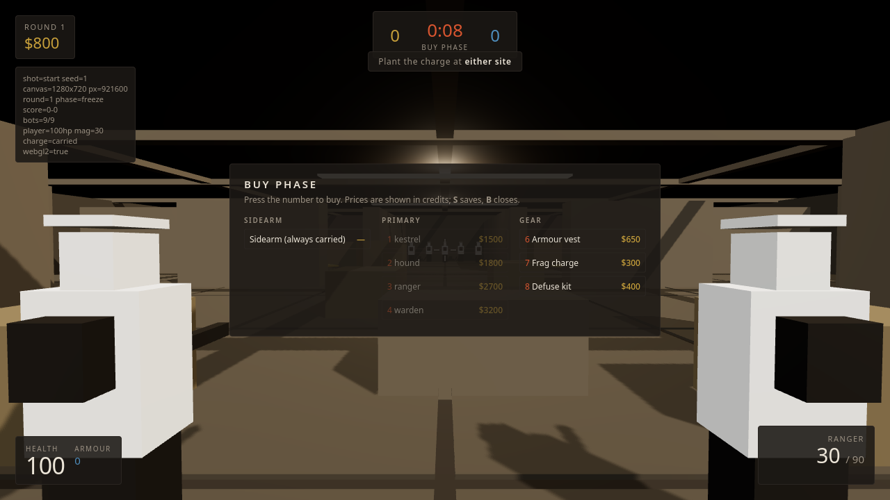

# Ember Depot

A round-based tactical first-person shooter that runs in the browser on three.js 0.187.0, entered in
[make.fun's threejs-fps-02 bounty](https://make.fun/bounty/threejs-fps-02).

Two five-player sides meet in a disused rail depot at dusk. **Raiders** carry a bomb and must plant it at
one of two sites; **Watch** must stop them or defuse it. First side to four rounds takes the match. Each
round opens with a freeze, then a buy phase where money earned last round decides what you carry in.



## Play

```
node serve.ts
```

Then open <http://localhost:8080>. No build, no install: three.js and the make.fun library are vendored
and the game is plain static ES modules.

| Input | Action |
| --- | --- |
| `W A S D` | move |
| mouse | look |
| left click | fire |
| right click | aim down sights |
| `Shift` | walk (quiet, accurate) |
| `Ctrl` | crouch |
| `R` | reload |
| `Space` | jump |
| `E` | plant / defuse the bomb |
| `G` | throw a grenade |
| `1` `2` | primary / sidearm |
| `B` | buy menu, in the buy phase |

## What is in it

**Gunplay.** Five weapons — Ranger and Hound rifles, Warden and Kestrel for close work, and a Sidearm —
each with its own recoil pattern, spread, penetration, damage falloff, magazine and reload. Hits resolve
per body part: head, torso and limbs take different multipliers, and armour absorbs a share before health
does. Bullets trace against the world, so a crate stops them and thin cover only slows the damage.

**Movement.** AABB collision against the depot geometry, air control, crouch and walk stances that trade
speed for silence and accuracy, and a camera that leans into the walk cycle.

**Tactics.** Bomb sites A and B with distinct approaches, a mid lane and two wings, 29 navigation
waypoints with hand-written routes and hold spots. Nine bots fill the match: they see through a field of
view with occlusion, hear gunfire and footsteps, and move through advance, hold, engage, search, plant and
defuse states. They fall back when hurt, hold angles on defence and push together on attack.

**Economy.** Round win and loss rewards, a loss bonus that grows with a streak, and a buy menu that
carries your weapon and armour across rounds only if you survive.

**Presentation.** A hand-built industrial map — roof trusses, skylights, crates, catwalks — lit by a
hemisphere/key/fill/rim rig with soft shadows and fog. All sound is synthesised in the Web Audio API:
gunfire per weapon, footsteps that differ by surface, reloads, the bomb beep and the explosion. No asset
files at all.

## Layout

```
main.ts                  the grader entrypoint: copies game/ and screenshots/, writes dossier.json
serve.ts                 a local static server
game/index.html          the page: import map, HUD, buy menu, overlay
game/src/                the game, in ES modules
game/vendor/three/       three.js 0.187.0 (MIT) and its core module
vendor/                  make.fun's dossier library, copied verbatim
screenshots/             3 renders, the first by name is the cover
```

`game/src` is where the work is: `map.js` and `world.js` build the depot, `player.js` and `input.js` the
movement, `weapons.js` and `match.js` the shooting, `bots.js` the opposition, `round.js` the match flow,
`audio.js` the sound, `hud.js` and `viewmodel.js` the presentation.

## Licence

MIT. three.js is MIT and vendored with its licence at `game/vendor/three/LICENSE`.
